# Castnet

[](https://github.com/AliKotb1/Castnet/releases/latest)
[](https://github.com/AliKotb1/Castnet/actions/workflows/ci.yml)


[](LICENSE)

**Catch any video on the web, and download anything fast.** A download manager for macOS with a browser extension for every browser a Mac can have.

**[⬇ Download Castnet for Mac](https://github.com/AliKotb1/Castnet/releases/latest)** (free, open source, macOS 13 or later)

- **The browser extension** works in the Chrome family (Chrome, Edge, Brave, Arc, Vivaldi, Opera, Chromium), the Firefox family (Firefox, Zen, LibreWolf, Floorp, Waterfox) and **Safari**. It watches network responses, recognizes video and audio (MP4/WebM/MP3…, HLS `.m3u8`, DASH `.mpd`), and puts a **Download this video** panel on any playing video. The panel lists every quality with its size, and an **×** closes it until you refresh. Sites that send picture and sound as two separate files (Facebook, Instagram, Reddit, Vimeo…) are detected by reading the file headers, and appear as **one** choice that downloads both and merges them.
- **Castnet.app** is a native download manager: toolbar, categories, queues with a scheduler, speed limiter, batch download, clipboard monitoring, and *Download File Info*, *download status*, *download complete* and *duplicate link* windows. It downloads with **up to 32 connections and dynamic segmentation**, handles HLS (including AES-128 encrypted streams, fMP4, separate audio and live recording) and DASH, and merges audio and video.

**Downloads that survive expired links.** Many sites hand out video links that stop working after a while, and download managers usually stop with an error. When that happens in Castnet, it gets a fresh link through your browser in the background, checks it's the same file, and **continues from the byte where it stopped**. Network drops are waited out and never count as failures.

The name: a cast net is the round fishing net that's thrown to catch everything beneath it. The icon shows one catching a play button. Castnet was called *Grabber* up to version 1.4.0; the first launch of 1.5.0 moves that version's download list, settings and unfinished downloads over by itself.

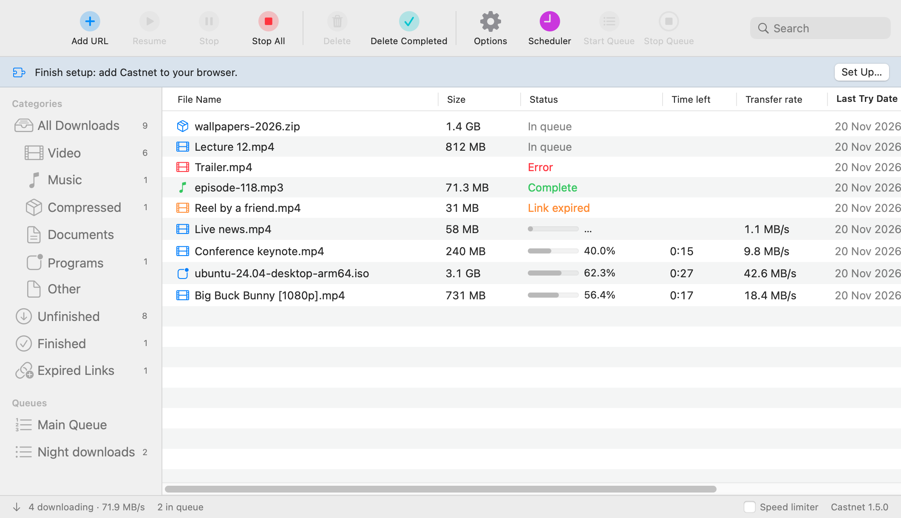

| Download status (16 connections) | Download File Info |
|---|---|
| 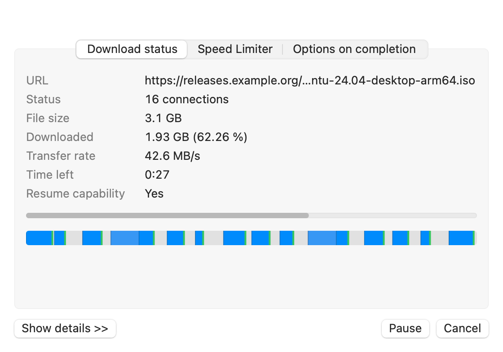 | 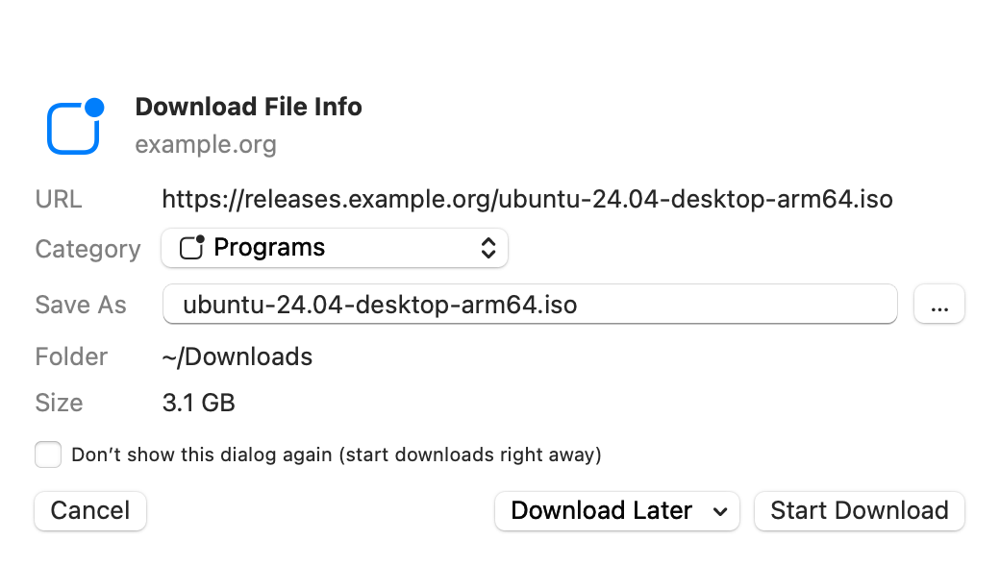 |

| In-page panel | Popup (YouTube) | Link picker |
|---|---|---|
| 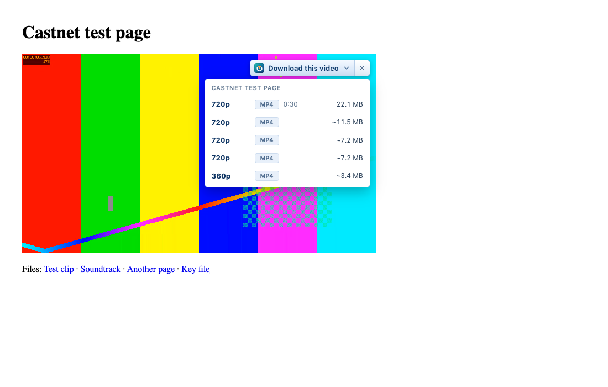 | 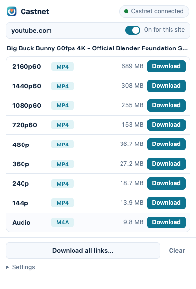 | 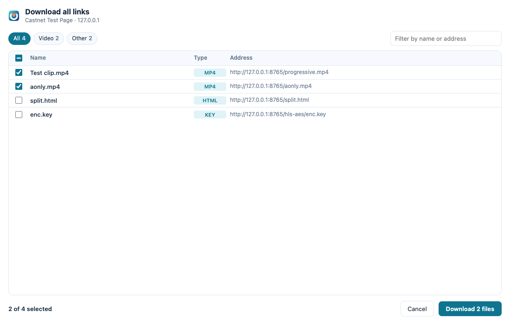 |

| Scheduler and queues | Batch download | Duplicate link |
|---|---|---|
| 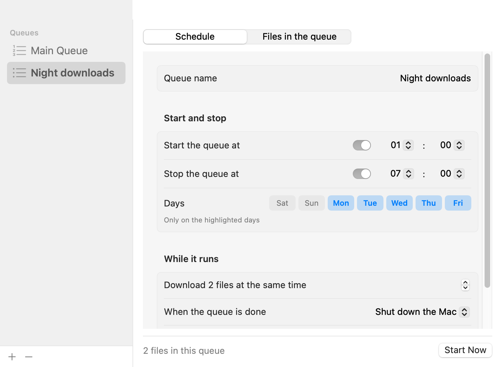 | 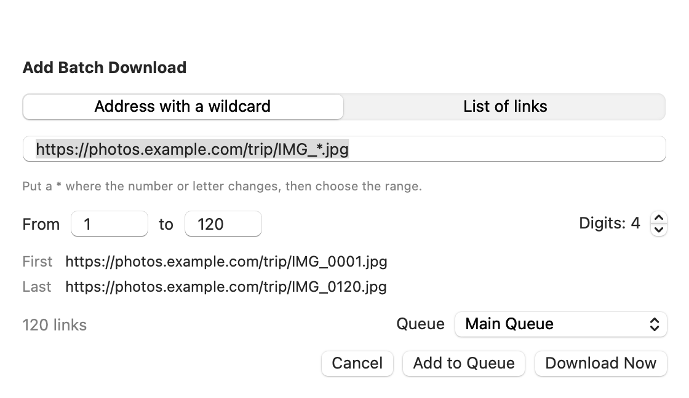 | 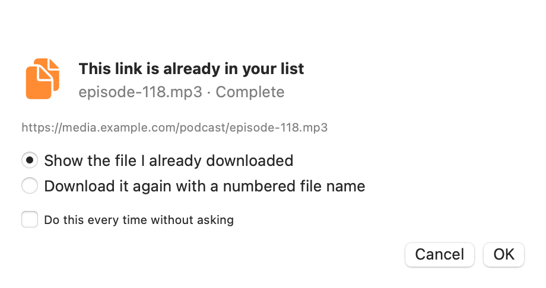 |

| Adding the extension to Chrome |
|---|
| 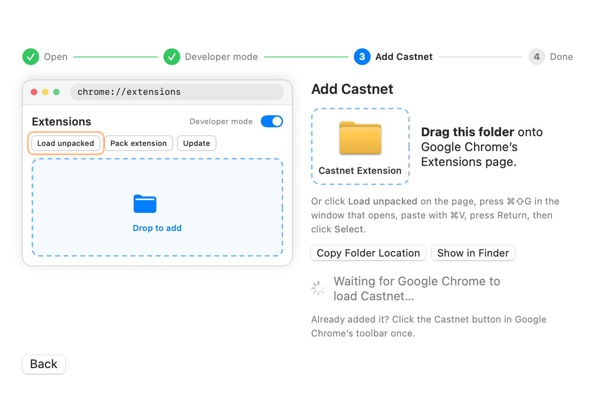 |

| Browser setup | Settings |
|---|---|
| 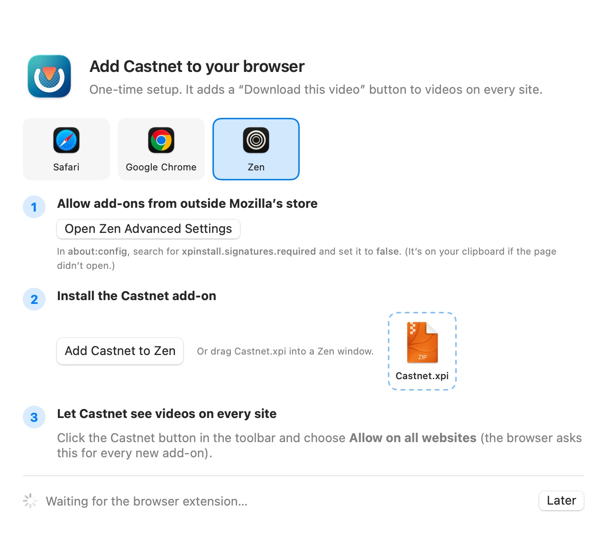 | 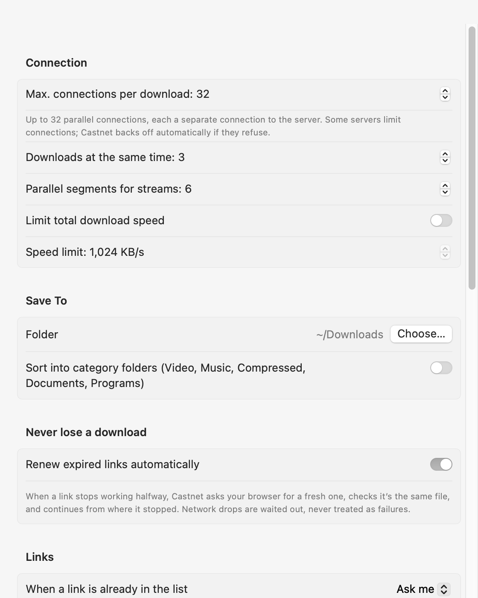 |

## Install (for users)

1. Download **Castnet-1.5.1.dmg** from [Releases](https://github.com/AliKotb1/Castnet/releases/latest), open it and drag **Castnet** into **Applications**.
2. Open Castnet. It checks which browsers are actually installed, connects itself to each of them, and opens **Set Up Castnet**, which shows only your browsers. Pick one and follow its steps:

| Browser | Steps in the setup window |
|---|---|
| Chrome, Edge, Brave, Arc, Vivaldi, Opera | A walkthrough shows each step on a drawing of the browser's Extensions page: open the page, turn on *Developer mode*, drag the Castnet folder onto it. It finishes by itself once the browser has loaded Castnet |
| Zen, LibreWolf, Floorp, Waterfox, Firefox Developer Edition / Nightly | In `about:config` set `xpinstall.signatures.required` to `false`, then click **Add Castnet to …**. Then click the Castnet toolbar button and choose *Allow on all websites* |
| Firefox (regular release) | Load it from `about:debugging` as a temporary add-on. Regular Firefox only installs add-ons signed by Mozilla permanently, so this lasts until Firefox restarts. Once the add-on is signed by Mozilla (see [docs/PUBLISHING.md](docs/PUBLISHING.md)) and built in with `SIGNED_XPI`, every Firefox-family browser installs it permanently with one click |
| Safari | The extension is built into Castnet.app. Until Castnet is signed by Apple, turn on *Allow unsigned extensions* in Safari's **Developer** settings (Safari turns it off again each time it quits), then enable Castnet in *Settings → Extensions* and allow it on all websites |

The setup window stays open until the extension first contacts the app, then says *You're all set*. You can reopen it from the Castnet menu.

Nothing else is needed: no Terminal, no Homebrew. Everything Castnet uses is inside the app:

| Built in | Used for | Notes |
|---|---|---|
| yt-dlp 2026.10.26 (official standalone build) | Quality lists and downloads for YouTube and 1,800+ sites | Keeps itself up to date once a day from yt-dlp's official releases (checksums verified). The update goes to `~/Library/Application Support/Castnet/bin`; the signed app is never changed. Can be turned off in Settings |
| FFmpeg 9.0.2 (minimal LGPL build) | Merging video + audio, TS→MP4 | Stream copy only, no re-encoding. Universal and static |
| QuickJS 2026-06-04 | YouTube's JavaScript challenges | Used instead of whatever runtime (deno/node) the Mac may or may not have |

**Gatekeeper:** without an Apple Developer ID, the app is ad-hoc signed. The first time, macOS says it can't verify the developer. Click **Done**, then go to **System Settings → Privacy & Security → Open Anyway**. Signing and notarizing with a Developer ID (see below) removes this step, and also lets Safari load the extension without *Allow unsigned extensions*.

**Sending updates:** raise the version (see [CHANGELOG.md](CHANGELOG.md)), then run `scripts/release.sh`. It builds the DMG, attaches it to a new GitHub release with checksums, and updates `castnet-update.json`, which every installed copy checks once a day to show an **Update available** banner.

## Publishing to the stores

Chrome Web Store, Edge Add-ons, Firefox Add-ons (addons.mozilla.org) and Safari (Developer ID signing and notarization): step by step in **[docs/PUBLISHING.md](docs/PUBLISHING.md)**. `node scripts/build-extensions.mjs` writes the upload packages to `dist/store/`.

## Build the DMG (for you)

```bash
./scripts/fetch-vendor.sh      # once per release: downloads yt-dlp, builds FFmpeg + QuickJS into ./vendor
./scripts/make-dmg.sh          # → dist/Castnet-<version>.dmg (universal: Apple Silicon + Intel)
```

The build also produces the three extension variants (`dist/extensions/chrome`, `firefox` + `Castnet.xpi`, `safari`) and puts them inside the app. Only the Command Line Tools are needed, not Xcode.

To sign for distribution, set `SIGN_IDENTITY="Developer ID Application: …"` and `NOTARY_PROFILE=<notarytool profile>` before `make-dmg.sh`. It signs everything with the hardened runtime (the Safari extension included), then notarizes and staples the DMG.

`scripts/install.sh` is only a developer shortcut. Users never need it.

## Use

**In the browser**

- **Play a video on any site.** A **Download this video** panel appears at the video's top-right corner. Click it to pick a quality (resolution · format · size). Click **×** to hide it until you refresh the page.
- **YouTube, Vimeo, X, TikTok, Instagram, Facebook and 30+ other sites** list every available quality, from 4K down to 144p plus audio only, even ones you haven't played. Downloads come out as MP4 (H.264/AAC where the site offers it) with picture and sound merged.
- **The toolbar popup** shows the same quality list, has an **On for this site** switch, and a **Download all links…** button.
- **Right-click menu:** *Download with Castnet* (on a link), *Download this video with Castnet*, *Download the video on this page*, *Download all links with Castnet*, *Download selected links with Castnet*. The two "links" items open a link picker with type filters.
- **Normal browser downloads** (zip, dmg, iso, mp4…) are handed to Castnet automatically in Chrome-family and Firefox-family browsers when the app is reachable. **Hold ⌥ Option while clicking** a link to keep that one in the browser. You can change the file types or turn this off under *Settings* in the popup. Safari doesn't let extensions take over downloads.

**In the app**

- **Toolbar:** Add URL (⌘N), Resume, Stop, Stop All, Delete, Delete Completed, Options, Scheduler, Start Queue, Stop Queue, and search.
- **Categories:** All Downloads, Video, Music, Compressed, Documents, Programs, Other, Unfinished, Finished, Expired Links and every queue, each with a count. Settings can also sort finished files into category folders.
- **Columns:** File Name, Size, Status, Time left, Transfer rate, Last Try Date, Description.
- **Download File Info** before each download (Save As, folder, category, *Start Download* / *Download Later*), a **download status** window per download (segment map, per-connection table, speed limiter, options on completion), and **Download complete** with *Open* / *Open With…* / *Open Folder*. Each of these can be turned off.
- **Connections:** 1–32 per download (default 8). Each connection is a separate connection to the server. If a server refuses that many, Castnet drops to fewer on its own.
- **Speed limiter:** for all downloads from the status bar, or for one download in its status window.
- **Queues and scheduler:** *Download Later* (or *Add to Queue*) puts a download in a queue. Make as many queues as you like. In the **Scheduler**, each queue gets a start time, a stop time, the days it runs, how many files download at the same time, and what to do when it's done: nothing, quit Castnet, put the Mac to sleep, or shut it down. Sleep and shut down show a countdown you can cancel first, and they only happen if the queue downloaded something and you didn't pause any of its files. *Files in the queue* sets the order (Move Up / Move Down).
- **One download's "when done":** the *Options on completion* tab of its status window can also quit, sleep or shut down when that download finishes.
- **Batch download** (Tasks menu, ⇧⌘N): an address with a `*` and a range (`IMG_*.jpg` from 1 to 120, zero-padded to 4 digits → `IMG_0001.jpg` … `IMG_0120.jpg`, or letters a–z), or a pasted list of links. *Add Batch Download from Clipboard* and *Import Links from File…* fill the list for you. *Export Links to File…* saves every address in the list.
- **Duplicate links:** adding a link that's already in the list asks whether to continue/show the existing download or download it again with a numbered name (or does what you chose in Settings).
- **Clipboard monitoring** (off by default, Settings → Links): copy a link to a video, music, archive, program or PDF file anywhere and Castnet offers to download it. macOS 15.4 and later ask whether Castnet may read the clipboard. Castnet first checks, without reading, that the clipboard holds a link, so the question only comes up for links. Choose *Always Allow* for Castnet in System Settings to stop the question.
- **Right-click a download:** Open, Open Folder, Resume, Stop, Progress Window…, *Refresh Link…* (Castnet also does this automatically), *Change Address…* (paste a new link and keep what's downloaded), Add to Queue, Move Up/Down in Queue, Remove from Queue, Redownload, Copy Address, Open Page in Browser, Remove from List, Move Files to Trash.
- Pausing and quitting lose nothing. Live streams have a ⏹ *Stop & save* button. The menu bar icon shows active downloads.

## When a link expires

Signed CDN links (Facebook, Instagram, Vimeo, many file hosts) often expire within hours. Castnet tells an expired link from a network problem:

- **Network down or flaky** (no route, timeouts, connection resets): it waits for the network to come back and continues. This never counts as a failure.
- **The server refuses the link** (403, 410, 401… with no data flowing, several times in a row): the item shows **Link expired** and keeps everything it has. Then:
  1. The app asks the extension for a fresh link to the same file.
  2. The extension reopens the page the download came from in a **muted background tab** and plays the video, so the site issues a new signed link. The old, expired link is never accepted back.
  3. The app checks the new link points to **the same file**: same total size, and a block of bytes it already downloaded matches what the new link returns.
  4. The download continues from the same byte with all its connections, and the background tab closes.

If you play the same video again yourself and click download, Castnet recognizes it as the expired download and continues that one instead of starting over (the panel says *✓ Continued your expired download*).

If the browser isn't running, the download waits; the extension checks for expired downloads every minute while the browser is open. HLS and DASH streams re-fetch their playlist or manifest to get fresh segment links. This can be turned off in Settings (*Renew expired links automatically*), and *Refresh Link…* / *Change Address…* do it by hand.

## How it works

```
 Web page ──fetch/XHR bodies──▶ inject.js (page world)
     │                              │ postMessage
     │ <video>, inline JSON         ▼
     └────────────────────────▶ content.js ──▶ background script
                                  overlay        webRequest sniffing · classifier ·
                                  panel          HLS/DASH parsing · cookies · link renewal
                                                      │
               Chrome / Firefox family                │                 Safari
               native messaging (stdio)               │       sendNativeMessage → CastnetSafari.appex
                         ▼                            │       (sandboxed) → loopback TCP + token
                  castnet-host                        │                      │
                         │ Unix socket (0600, launches the app if needed)    │
                         ▼                                                   ▼
                     Castnet.app ── SegmentedDownloader (up to 32 connections, link renewal)
                                 ├─ HLSEngine  (AES-128, fMP4, alt audio, live, playlist refresh)
                                 ├─ DASHEngine (Template/Timeline/List/Base, manifest refresh)
                                 ├─ YTDLPEngine (bundled yt-dlp + QuickJS)
                                 └─ ffmpeg stream-copy mux → .mp4
```

How it finds media on any site, in three layers:

1. **Network sniffing** (`extension/background.js`). Every response's `Content-Type`, `Content-Range`/`Content-Length`, `Content-Disposition` and URL extension go through a classifier (`extension/lib/detect.js`). It recognizes files and manifests, and drops stream segments, ads under a size threshold, images and pages. In Safari, which gives extensions less of `webRequest`, layers 2 and 3 do most of this work.
2. **Page-world hook** (`extension/content/inject.js`). It wraps `fetch`/`XMLHttpRequest`, scans JSON/text bodies for stream URLs and notes media requests, catching players that load their source from an API. It's generic: no per-site rules.
3. **Page scan** (`extension/content/content.js`). It checks `og:video` tags, `<video>`/`<source>` sources and inline `<script>` JSON. URLs found by layers 2 and 3 are confirmed with a 1-byte range request before they're listed.

**One extension, three browsers:** `scripts/build-extensions.mjs` turns `extension/` into a Chrome MV3 service-worker build, a Firefox MV3 build (background script, gecko ID `castnet@castnet.app`, packed as `Castnet.xpi`) and the Safari web-extension resources. The code runs against `browser ?? chrome`, and features a browser lacks (for example `webRequest` extra headers, download takeover in Safari) are skipped.

**Downloads are quarantined like browser downloads:** every finished file gets macOS's quarantine flag with its source address. So an app, installer or disk image downloaded with Castnet is checked by Gatekeeper before it first opens, exactly as if Safari or Chrome had downloaded it.

**Replaying the browser's identity:** every download carries the exact request headers (Referer, Origin, User-Agent, Authorization…) and the cookie jar for the URL's domains. The app attaches cookies per host (redirects included), so signed or logged-in URLs keep working outside the browser.

**Dynamic segmentation** (`app/Sources/CastnetCore/SegmentedDownloader.swift`):
1. A probe connection asks for `bytes=0-` to learn the size and confirm range support.
2. Whenever a connection slot is free, the largest unfinished segment is split in half and a new connection starts on its second half. The original connection is cut off when it reaches the new boundary. Each connection has its own `URLSession`, so the server sees separate TCP connections, up to 32.
3. Each connection writes at its own offset into a sparse `.castnet-part` file.
4. The segment table is saved, so pausing, quitting and expired links lose nothing.
5. `If-Range` with the ETag catches files that changed on the server.

## Not supported

- **DRM** (Widevine, FairPlay, PlayReady, i.e. Netflix, Disney+, Spotify and similar). It's detected (`SAMPLE-AES`, `KEYFORMAT`, `<ContentProtection>`) and refused. Standard HLS AES-128 is just transport encryption and is supported.
- **YouTube's own player streams** use the SABR/UMP protocol, so no plain file URL ever appears on the network. Its qualities come from the built-in site extractor.
- **YouTube and your login:** when YouTube sees a signed-in session, it streams only through its own protocol with proof-of-origin tokens. That leaves just the old 360p MP4 (format 18) downloadable. So Castnet lists and downloads YouTube videos **without your login** first, and runs the signed-in lookup in parallel only as a fallback for videos that need it (age-restricted, members-only, private). Those may still be limited to 360p. YouTube changes often, and the built-in extractor updates itself daily to keep up.
- **Permanent install in regular Firefox** needs the add-on signed by Mozilla, and **Safari without the Developer setting** needs Castnet signed with an Apple Developer ID. Both are distribution steps, not code changes.

## Develop and test

```bash
./scripts/build.sh          # → dist/Castnet.app (app + castnet-host + castnet-cli + Safari extension)
./test/run-all.sh           # generates MP4/HLS/DASH/live test media with ffmpeg, runs unit, engine and
                            # download-manager tests (queues, scheduler, duplicates, batch, quarantine)
node test/e2e.mjs /tmp/x [--youtube]   # real Chrome + extension in a throwaway profile; requests are
                                       # recorded by test/fake-host.py, never sent to your app
node test/e2e-renew.mjs /tmp/x         # real Chrome + a headless test copy of Castnet: the video link
                                       # expires mid-download and must be renewed and finished byte-identical
python3 test/zen-firefox.py /tmp/x [browser-binary]   # Zen/Firefox through Marionette with a throwaway profile
./test/dmg-test.sh dist/Castnet-1.5.1.dmg   # installs the DMG into a sandbox with no Homebrew and downloads from it
```

The e2e tests use a separate test copy of the app (`CASTNET_HOME`, `CASTNET_HEADLESS`): own folder, own settings, own socket, never your real download list.

`castnet-cli` uses the same engines as the app and works on its own:

```bash
dist/Castnet.app/Contents/MacOS/castnet-cli --connections 32 --out ~/Movies URL
dist/Castnet.app/Contents/MacOS/castnet-cli --quality 720 https://…/master.m3u8
dist/Castnet.app/Contents/MacOS/castnet-cli --limit 2048 URL      # KB/s
dist/Castnet.app/Contents/MacOS/castnet-cli --send URL            # queue it in the running app
```

`dist/Castnet.app/Contents/MacOS/Castnet --snapshot out.png [--setup | --settings | --status | --info] [--dark] [--empty]` renders a window with demo rows. This works without Xcode. The Command Line Tools ship without SwiftUI's macro plugin, which is why the views use `ObservableObject` instead of `@State`.

Project layout:

```
extension/                 the extension source (Chrome MV3 as-is; Firefox/Safari builds generated)
  background.js            sniffing, state per tab, native messaging, download takeover, link renewal
  lib/detect.js            response classifier (pure, unit-tested)
  lib/manifests.js         HLS/DASH summaries for the UI (pure, unit-tested)
  lib/probe.js             MP4/WebM header reading to pair separate video and audio
  content/inject.js        page-world fetch/XHR scanner
  content/content.js       page scan + in-page Download panel
  popup/  picker/          toolbar popup, link picker
app/                       Swift package
  Sources/CastnetCore/     engines, link renewal, queues, IPC server, download manager, migration from the old name
  Sources/Castnet/         AppKit + SwiftUI app (main window, dialogs, browser setup)
  Sources/castnet-host/    native-messaging bridge
  Sources/castnet-cli/     headless downloader
  Sources/castnet-selftest/ in-process tests of the download manager (not shipped in the app)
  SafariExtension/         Safari web-extension handler (talks to the app's token-protected bridge)
scripts/                   build, DMG, extensions, Safari appex, FFmpeg, vendor tools, icons
test/                      media generator, test server, unit, engine, e2e and DMG tests
docs/                      publishing guide, icon, screenshots
keys/extension-key.pem     (not in the repository) private key behind the fixed extension ID; only needed to pack a .crx
```

## Contributing

Bug reports and pull requests are welcome: see [CONTRIBUTING.md](CONTRIBUTING.md), and report security problems privately as described in [SECURITY.md](SECURITY.md). Changes are listed in [CHANGELOG.md](CHANGELOG.md).

## License

Castnet is released under the [MIT License](LICENSE). The app bundles yt-dlp (Unlicense), FFmpeg (LGPL 2.1+) and QuickJS (MIT) as separate programs; see [THIRD_PARTY_NOTICES.md](THIRD_PARTY_NOTICES.md).

Use Castnet only for content you have the right to download. Respect the terms of the sites you use it on.
